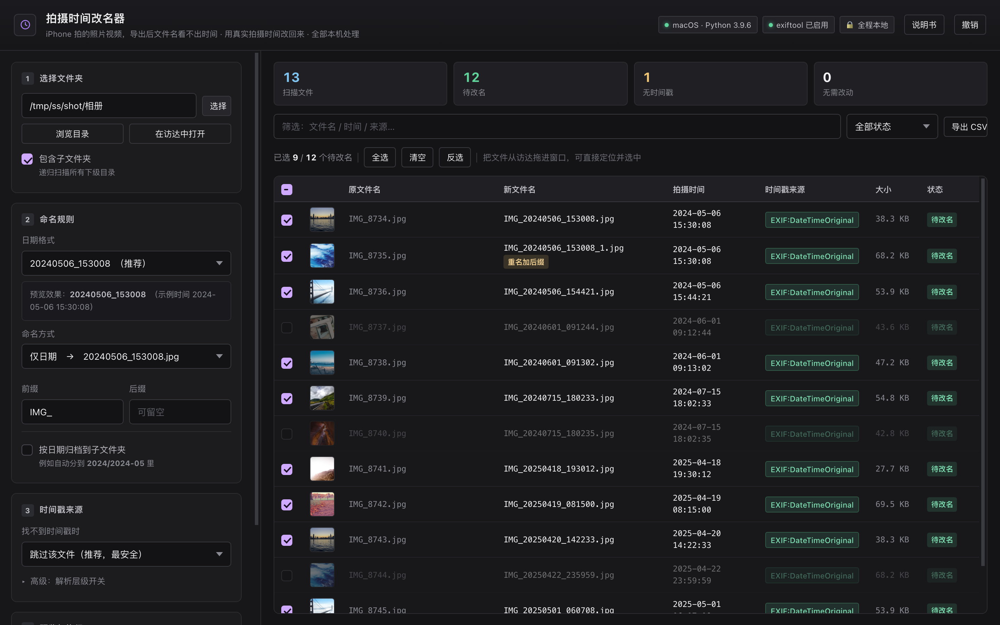
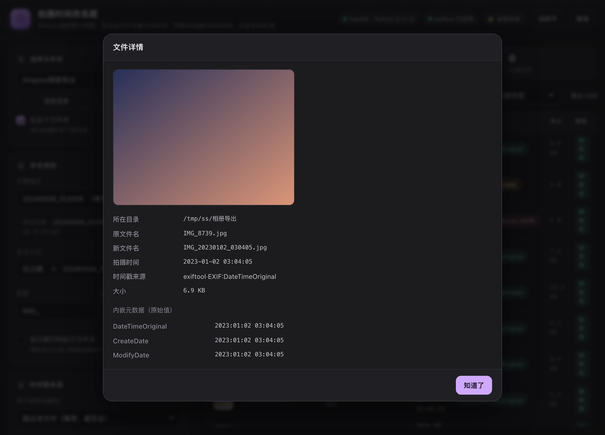
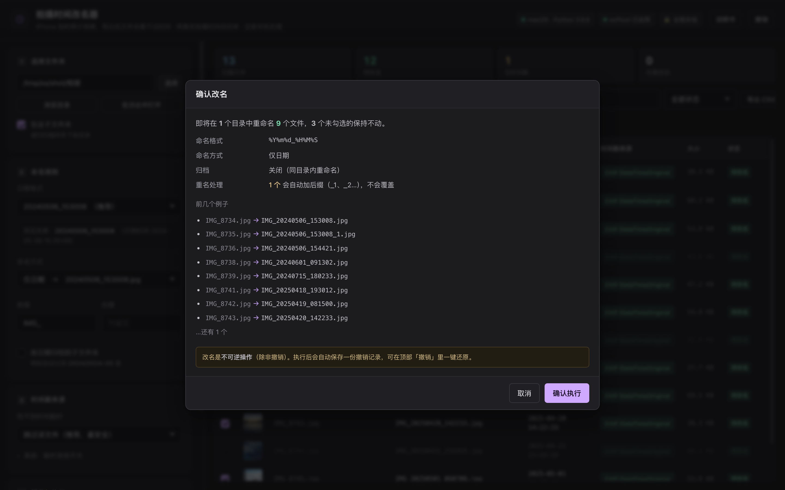
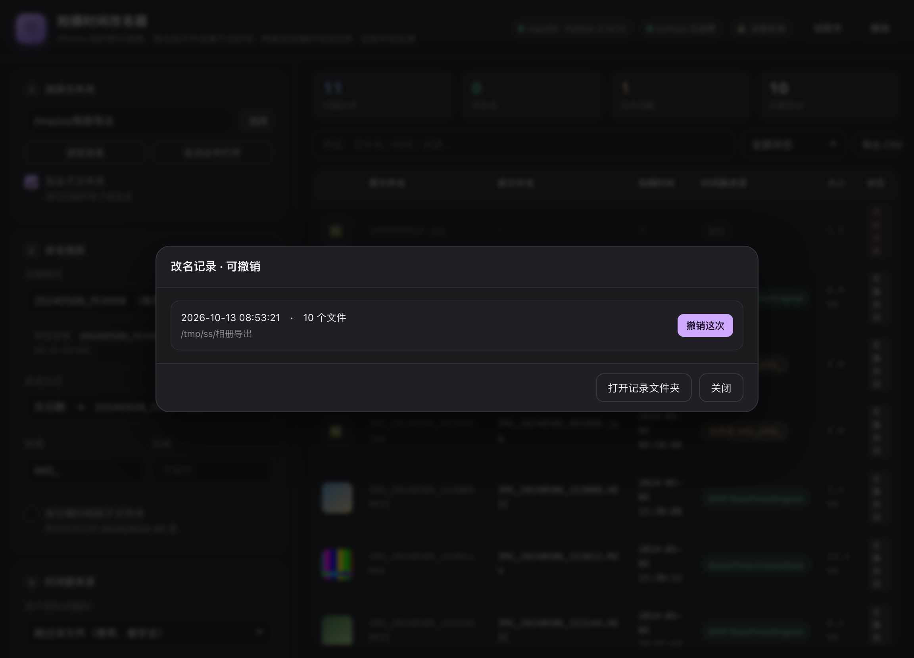

<div align="center">

# ShutterSort

**Write the iPhone capture time back into the filename.**

*(Chinese name: 拍摄时间改名器)*

[](LICENSE)
[](https://www.python.org/)
[]()
[]()
[](#development--testing)

[中文说明](README.md) · English

</div>

---

Photos and videos shot on an iPhone come off the camera as a bare serial number ——
once exported to a computer, a drive or the cloud, nothing in the filename says *when* it was taken:

```
IMG_8734.HEIC
IMG_8734.MOV
IMG_8741.HEIC
```

ShutterSort does one thing: **replace those names with the real capture time** read back
from the file's embedded metadata.

```
IMG_8734.HEIC   →  IMG_20240506_153008.HEIC
IMG_8734.MOV    →  IMG_20240506_153012.MOV
IMG_8741.HEIC   →  IMG_20240506_154421.HEIC
```

Afterwards the folder sorts chronologically by itself, matching what you see in your photo app ——
and the filename *is* the timestamp, so search, backup and sync all just work.

## Highlights

- **Auditable timestamps** — every file is tagged with *where* its time came from. No black boxes.
- **Zero dependencies** — pure Python standard library. No `pip install`, no venv, no config.
- **Self-contained parsers** — TIFF/EXIF, XMP, PNG chunks, WebP and ISOBMFF (MP4/MOV/HEIC) are all parsed in-house, so nothing breaks when external tools are missing.
- **Deterministic & idempotent** — re-running on an already-renamed folder reports "no change" instead of appending `_1`.
- **Persistent undo** — every run writes a JSON history file; undo works across sessions.
- **Safe by default** — conflict handling with `_1`/`_2` suffixes, overwrite protection in both rename and undo directions, and no-timestamp files are skipped rather than guessed.
- **Cross-platform** — one codebase for Windows, macOS and Linux. Same features, same UI, no per-platform forks.

## Screenshots

**Preview before touching anything** — note the colored timestamp-source tags:



**You decide which files get touched** — every row has a checkbox; unchecked files stay exactly as they are.

- Everything is checked right after a scan, so "just rename all" still works in one click
- The toolbar shows `N of M selected`, with **Select all / Clear / Invert**.
  All three only apply to the rows **currently visible after filtering**
- Drop files from Finder / Explorer onto the window and they get located and checked
  automatically (same name? byte size breaks the tie). Files not in the list are reported
- The header checkbox is tri-state: all / partial / none

**Click any row to inspect the source and raw embedded metadata:**



**Confirmation dialog before the actual rename:**



**Persistent, cross-session undo:**



## Quick start

### Windows

**Option 1 — download the standalone exe (easiest)**

Grab `ShutterSort.exe` from [Releases](https://github.com/js-ping/shuttersort/releases) and double-click it.
Single file, no installer, no Python needed.

> If SmartScreen blocks it the first time, click *More info* → *Run anyway*. That's normal for an
> unsigned binary — the whole app is pure Python standard library, the source is in `src/`, and you
> can always build your own with `build_exe.bat`.

**Option 2 — run from source**

Windows 10/11 with Python 3.8+. When installing from [python.org](https://www.python.org/downloads/windows/),
**tick `Add python.exe to PATH`** on the first screen, then:

```bat
git clone https://github.com/js-ping/shuttersort.git
cd shuttersort
start.bat
```

**Option 3 — build your own exe**

Double-click `build_exe.bat`. It installs PyInstaller, generates the icon and produces `dist\ShutterSort.exe`.
(There's also [CI](.github/workflows/build-desktop.yml): push a `v*` tag and GitHub builds both the exe and
the `.app` on real Windows and macOS runners and attaches them to the release.)

### macOS

**Option 1 — grab the prebuilt `.app` (easiest, Apple silicon only)**

Download `ShutterSort-macOS-arm64.zip` from [Releases](https://github.com/js-ping/shuttersort/releases),
unzip it and drag `ShutterSort.app` into `/Applications`. No Python needed.

Supports M1 / M2 / M3 / M4, macOS 11+. **Intel Macs can't run this build** — use Option 2.

> If macOS says *"Apple cannot check it for malicious software"*: **right-click the app → Open → Open**.
> That's a one-time approval. Or run `xattr -dr com.apple.quarantine /Applications/ShutterSort.app`.
> It's the normal cost of not buying an Apple Developer certificate; the zip ships with a note explaining this.

**Option 2 — run from source**

Python 3.8+ (built in on macOS):

```bash
git clone https://github.com/js-ping/shuttersort.git
cd shuttersort
./start.command
```

**Option 3 — build your own `.app`** (native window, no Python required on the machine):

```bash
python3 -m pip install pyinstaller pywebview   # once
cd packaging
./build_app.command
```

### Linux

```bash
git clone https://github.com/js-ping/shuttersort.git
cd shuttersort
./start.command          # or: python3 src/server.py
```

A terminal window opens, then your browser opens the UI. There is nothing to install —
no `pip install`, no venv, no config file.

### Optional extras (all of them optional)

| Tool | Purpose | Without it |
| --- | --- | --- |
| `exiftool` | Highest-coverage metadata extraction | Falls back to built-in parsers, fully functional |
| `ffmpeg` | Video thumbnails (and a HEIC fallback) | Shows a 🎬 icon; renaming unaffected |
| `magick` (ImageMagick) | HEIC thumbnails on Windows / Linux | Placeholder icon; renaming unaffected |

> The **folder picker** uses whatever the OS already provides — `osascript` on macOS,
> PowerShell + .NET on Windows, `zenity`/`kdialog` on Linux. When none is available the UI
> falls back to typing a path manually; nothing else changes.

## Timestamp precedence

For every file the first usable timestamp wins, and the UI shows which layer was used:

1. **exiftool** (if installed)
2. **Container time** — MP4/MOV/HEIC: `com.apple.quicktime.creationdate` → `mvhd` → `mdhd`, UTC converted to local time
3. **Embedded XMP** (JPEG/PNG/WebP)
4. **EXIF** — `DateTimeOriginal` → `DateTimeDigitized` → `DateTime`, incl. `OffsetTime*` time zones and `SubSecTime*` milliseconds
5. **PNG `tIME` chunk**
6. **Google Takeout `.json` sidecar**
7. **`.xmp` sidecar**
8. **Filename parsing** — 10 patterns (DJI, IMG/VID, WhatsApp, screenshots, Chinese dates, `PXL_`, 14-digit stamps, …)
9. **Filesystem time** (opt-in fallback, clearly labelled as *not* a capture time)
10. Nothing → skipped, tagged "no timestamp". **Never guessed.**

Purely numeric names such as `1000000034.jpg`, UUIDs and long hashes are recognized and skipped,
with an extra year-plausibility check on top.

## Naming

**Default output: `IMG_20261012_122123.jpg`** — prefix `IMG_` plus format `%Y%m%d_%H%M%S`.
Both are editable in the UI (clear the prefix and you get `20261012_122123.jpg`).

Patterns: `Date only` (default), `Date_original`, `Original_date`, `Original only`.
Custom strftime-style formats and optional **archiving into date subfolders** (`2024/2024-05/`) are supported too.

## Privacy

- No network access — the server binds to `127.0.0.1` only
- No uploads of files, names or metadata
- No content modification — renaming (plus an optional move for archiving)
- Overwrite protection in both rename and undo directions

## Performance

| Workload | Time |
| --- | --- |
| 100 photos | < 1 s |
| 10 000 files | 20–60 s |
| One 4 GB 4K video | Milliseconds — only the header boxes are read |

Parallel scanning scales with CPU cores; videos are read header-only, never loaded whole.

## Development & testing

```bash
python3 tests/selftest.py       # macOS / Linux
python tests\selftest.py        # Windows
```

Or just double-click `tests/run_tests.command` (macOS/Linux) / `tests/run_tests.bat` (Windows).

55 regression checks cover the parsers, filename rules, the naming engine, the full HTTP flow
(scan → preview → rename → idempotent re-scan → undo) and API security (path traversal protection).
Everything runs in a temp directory and cleans itself up.

## Project layout

```
ShutterSort/
├── start.command / start.bat  ← double-click launcher (macOS·Linux / Windows)
├── build_exe.bat              ← double-click: build the Windows standalone exe
├── src/
│   ├── media_time.py          ← timestamp parsing engine (the core)
│   ├── server.py              ← local server + all endpoints
│   ├── app_main.py            ← native-window entry point (.app / .exe)
│   └── static/index.html      ← UI (single file, no build step)
├── tests/selftest.py          ← 55 regression checks
├── packaging/                 ← build scripts + icons (make_ico.py writes the .ico)
│   ├── build_app.command      ← builds the macOS .app + a shippable zip
│   ├── mac/FIRST-RUN.txt      ← the "first launch" note packed into the zip
│   └── ci/RELEASE_NOTES.md    ← release body (edit this one before a release)
├── .github/workflows/         ← tag a release → exe + .app built and attached
└── rename-history/            ← created at runtime: undo records (don't delete)
```

## License

[MIT](LICENSE)
