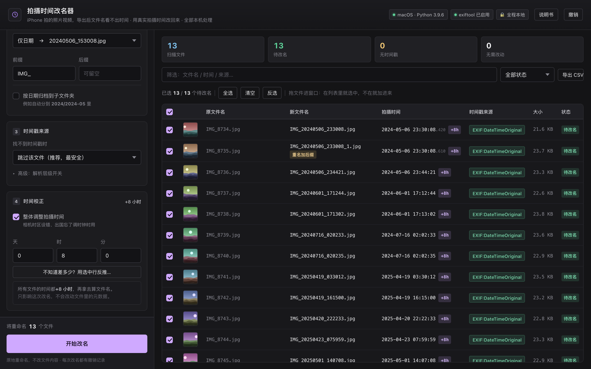

<div align="center">

# ShutterSort

**Rename your phone photos to the time they were actually taken.**

Once renamed, the whole folder sorts itself by capture time — exactly the order you see in your phone's gallery.


[简体中文](README.md) · English

</div>

---

> **This is a macOS app.** Starting with 1.8.0 there is no Windows or Linux build —
> better to do one platform properly than three halfway. Old `.exe` files remain in the
> Release history but are no longer updated.

## See it first

Straight off your phone, the names look like this — three files, no idea when they were shot:

```
IMG_8734.HEIC
IMG_8734.MOV
IMG_8741.HEIC
```

Afterwards:

```
IMG_20240506_153008.HEIC
IMG_20240506_153012.MOV
IMG_20240506_154421.HEIC
```

Three in the afternoon on May 6, 2024, at a glance. Sort by name and you sort by time — searching, backing up, and moving files between devices all get easier.

**It never touches your photos.** Only the names change; not a single byte of file content. Renamed by mistake? One click undoes it.

> **Good fit**: photo libraries that have grown past the point where filenames mean anything;
> bulk exports from WeChat or Google Photos; a whole batch shot with a camera whose clock was wrong.
>
> **Not a fit**: face / place / event auto-tagging; editing the metadata inside photos; cloud sync.
> It does one thing — renaming — and tries to do it properly.

## Three steps

**1. Download**

Grab the latest `ShutterSort-x.x.x-macOS-universal.dmg` from
[Releases](https://github.com/js-ping/shuttersort/releases), double-click to mount, drag the
icon into **Applications**.

Universal binary — Apple Silicon and Intel both work, no choosing. Requires macOS 14 (Sonoma) or newer.

**2. Drag the folder with your photos into the window**

You can also use "Choose Folder", or pick a handful of individual files.

**3. Check the preview on the right, then click "Start renaming"**

The preview lists what every file will be called. If something looks wrong, just don't click —
nothing has been changed at that point.

> First time? Copy the folder you want to tidy up and practise on the copy.
> Undo works, but a copy is the most worry-free way to learn the buttons.

> ⚠️ **macOS will block the first launch**, because the app isn't code-signed (an Apple
> certificate costs $99/year). In Finder, **right-click the app → Open → Open**.
> You only need to allow it once; after that a normal double-click works.

## What it solves

Shot on a phone, forwarded through a chat app, exported from Google Photos, taken with a camera or a drone — if the name has no time in it, this finds the real one.

| Your situation | What it does |
| --- | --- |
| `IMG_8734.HEIC` exported from an iPhone | Reads the capture time stored inside the photo |
| `IMG_8734.MOV` recorded on a phone | Reads the creation time recorded in the video container |
| Forwarded through WeChat / WhatsApp, metadata stripped | Pulls the time out of the filename |
| A pile exported from Google Photos | Reads the `.json` sidecar that came with the export |
| Burst shots, several landing in the same second | Reads sub-second precision, so order matches the shutter |
| Camera clock was off by 8 hours | Shifts the whole batch — filenames only, originals untouched |
| Names full of junk (`_edited`, stray numbers) | Cleans them up with rename rules |

**It tells you where each time came from.** Every row carries a small coloured tag — "Embedded·EXIF", "Filename", "Takeout JSON". You can check them one by one, instead of renaming a hundred files and still not knowing why.

**It only touches what you tick.** Everything is selected after a scan; anything you untick stays exactly as it was.

**Rescanning changes nothing.** Files that are already correct show as "No change needed" — no suffix gets appended twice.

**No timestamp means skipped.** Those rows are marked "No timestamp" — it will never invent a time to look busy.

## Screenshots

> These are illustrative — they show what each area does. The running app is the source of truth.

**Everything is visible before you commit — the files are still untouched here:**


**Click any row to see where the time came from and the raw metadata:**


**One more confirmation, listing how many files, what naming options, and any collisions:**


**Every rename is logged, so undo still works after a reboot:**


**Wrong camera clock? Shift the time — filenames change, the data inside doesn't. The stack of "rename rules" on the left is the processing order for the middle part of the name:**



## Naming

The default is `IMG_20240506_153008.jpg` — a prefix `IMG_` plus date and time. Both are editable in the left panel; clear the prefix and you get `20240506_153008.jpg`.

Four ways to combine the date with the original name:

| Choice | Result |
| --- | --- |
| Date only (default) | `20240506_153008.jpg` |
| Date_Original | `20240506_153008_IMG_8734.jpg` |
| Original_Date | `IMG_8734_20240506_153008.jpg` |
| Original only | `IMG_8734.jpg` (prefix/suffix only, no time) |

The date format is editable — e.g. `2024-05-06`. It can also **file photos into dated subfolders** automatically, like `2024/2024-05/`.

**If two files resolve to the same name**, `_1`, `_2` is appended automatically. An existing file is never overwritten.

### Got a chunk of the name you don't want? Use rename rules

Prefix and suffix only reach the two ends, but the annoying part is usually in the middle: the camera's `IMG_`, an editor's `_edited`, redundant seconds, a long ID an import tool bolted on.

These run in order on the finished name. Five rule types:

| Rule | What it does | Example |
| --- | --- | --- |
| Insert | Insert text after position N, or before / after a piece of text | `20240506_153008` → `20240506-_153008` |
| Delete | Delete N characters from position N, or everything to the end | `IMG_20240506_153008` → `20240506_153008` |
| Replace | Swap one piece for another; leave the replacement empty to remove | `IMG_` → `photo_` |
| Strip characters | Remove every space / underscore / bracket / digit at once | Remove all underscores |
| Change case | lower / UPPER / Title Case / Sentence case | `DSC` → `dsc` |

- Rules run top to bottom; each one's output feeds the next. Every rule can be disabled or reordered
- **You never count positions by hand**: a strip of characters sits under each position-based rule — click one to set the position.
  That strip shows the name *as it is when this rule runs*, so an earlier rule that turned `IMG_` into `photo_` (a different length) can't make you click the wrong spot
- Spaces are drawn as `·`, tabs as `→`, so invisible characters can't be miscounted

**Two guard rails**: the extension is never harmed (rules only see the part before `.jpg`); and if a rule deletes everything, the unedited name is used rather than producing a file called `.jpg`.

<details>
<summary>Why there is no auto-numbering and no regex</summary>

The rule set was modelled on [ReNamer](https://www.den4b.com/products/renamer), deliberately dropping three things:

- **Auto-numbering**: it breaks "rescanning changes nothing". Numbering drifts as soon as you select a subset of files, which kills the core promise. Bursts are already ordered by sub-second precision, collisions already get `_1` `_2`
- **Regex / scripts**: too high a barrier, too easy to get wrong — it conflicts with "anyone can use this"
- **Extension changes / randomise / transliterate**: unrelated to capture time; changing extensions on photos is risky

</details>

### Several bursts in the same second

A second holds several frames, and their timestamps look identical. The app reads the finer part stored in the file (milliseconds, microseconds) and orders by that — so `_1` and `_2` follow the shutter, and rescanning on another machine won't swap them. The table shows that precision as three small digits.

### Camera clock was wrong

Wrong timezone, forgot to change the clock abroad, a batch of old photos that's all off — tick "Time correction" in the left panel and fill in days / hours / minutes (negative goes back). Filenames are generated from the corrected time.

Not sure by how much? Select a suspicious row, click "Don't know the offset? Derive it from the selected row…", and type the photo's **real** capture time — the offset is computed and filled in.

> Correction affects the generated filename only — **EXIF data inside the photo is never rewritten**. The original value stays; set the offset back to 0 and start over.
> Corrected rows carry an orange tag (e.g. `+8h`); hover to see the original time.

## Where the time comes from

The app walks down a fixed list and **stops at the first usable answer**, then tells you which layer it came from:

1. **Stored in the photo** — the capture time embedded in the file. Most accurate, tried first
2. **Stored in the video container** — creation time recorded in MP4 / MOV / HEIC; timezone-aware values are converted to your local time
3. **Stored next to the file** — the `.json` from a Google Photos export, the `.xmp` an editor writes beside the photo
4. **Written in the filename** — 10 common patterns from DJI, chat apps, screenshot tools, Chinese dates
5. **The file's own timestamp** — note this is *not* capture time, it's when the file landed on disk. Off by default; you have to enable it

If all five fail, the file is skipped and marked "No timestamp" — **no invented times**.

<details>
<summary>Full priority list, and "do I need exiftool?"</summary>

| Order | Source | Notes |
| :-: | --- | --- |
| 1 | exiftool (if installed) | Broadest standard metadata extraction |
| 2 | Container time (MP4/MOV/HEIC) | `com.apple.quicktime.creationdate` → `mvhd` → `mdhd`, UTC converted to local time |
| 3 | XMP (embedded in JPEG/PNG/WebP) | `xmp:CreateDate`, `photoshop:DateCreated` |
| 4 | EXIF (JPEG/TIFF/RAW/WebP) | `DateTimeOriginal` → `DateTimeDigitized` → `DateTime`, honours `OffsetTime*` and `SubSecTime*` |
| 5 | PNG `tIME` chunk | The saviour for phone screenshots |
| 6 | Google Takeout `.json` sidecar | Accurate capture time from a Google Photos export |
| 7 | `.xmp` sidecar | Written by editors next to the image |
| 8 | Filename parsing | 10 common patterns, see below |
| 9 | Filesystem time (opt-in fallback) | Explicitly labelled as "landed on disk", not capture time |
| 10 | Nothing | Skipped, marked "No timestamp" |

**exiftool is entirely optional.** All core formats are parsed in-house, standard library only:

- **EXIF in JPEG / TIFF / RAW**: walks the TIFF IFD structure directly; supports ARW / NEF / CR2 / DNG / RW2 / ORF / SRW and friends
- **MP4 / MOV / HEIC / AVIF**: parses the ISOBMFF box structure, takes QuickTime creation time from `keys` + `ilst`, falls back to `mvhd` / `mdhd`
- **HEIC / HEIF**: follows `meta` → `iinf` / `iloc` to the Exif item, with a TIFF magic-number scan as backup
- **PNG / WebP**: parses chunks directly (`tIME` / `eXIf` / EXIF / XMP)

</details>

<details>
<summary>The 10 filename patterns it recognises</summary>

| Pattern | Example |
| --- | --- |
| DJI Fly | `dji_fly_20251108_164116_0042_D.MP4` |
| DJI | `DJI_20251108_164116_0042_D.MP4` |
| IMG_ / VID_ | `IMG_20250418_193012.jpg` |
| 14 consecutive digits | `IMG_20200101000000_0001.jpg` |
| Generic | `20251111_184839.png` / `2025-11-08_16-41-16.mp4` |
| WhatsApp | `IMG-20240125-WA0001.jpg` |
| Screenshot | `Screenshot 2024-09-15 at 10.20.30.jpg` |
| Chinese date | `2024年5月6日 event.jpg` |
| WeChat / Pixel | `PXL_20240506_153008123.jpg` |

**Pure numeric IDs are not mistaken for dates.** A name like `1000000034.jpg` that can't form a valid date is recognised and skipped; same for UUIDs and long hashes, with a year-range sanity check as the last line of defence.

</details>

## FAQ

**Q: Can it damage my photos?**

No. Only filenames change; content is untouched byte for byte, and the metadata inside is never rewritten. If something goes wrong, one click in the rename history restores everything.

**Q: Will my phone's gallery still recognise the files after renaming?**

This tool works on files already copied to your Mac. Renaming inside the phone's library isn't in scope — it changes files on your Mac or an external drive, and never touches the phone's gallery.

**Q: Why do some files show "No timestamp"?**

Their metadata was stripped: forwarded through WeChat / QQ / WhatsApp, re-saved by a screenshot tool, or exported by an online editor. You can enable the filesystem-time fallback (keeping in mind it's when the file landed on disk, not necessarily when it was shot), or just leave them skipped.

**Q: Do I need exiftool?**

No. Installing it improves accuracy on some rare cameras' RAW files, but nothing is missing without it — all parsing is done by the app itself.

**Q: The times are off by several hours?**

EXIF times carry no timezone, so the app can't guess where you were. Sources that do carry a timezone (video container creation time, EXIF with `OffsetTime`) are converted automatically and won't drift.

**Q: Video times are exactly 8 hours earlier than the photos?**

Check the "Source" column first:

- `Embedded·mvhd creation time` — the built-in parser reads the UTC seconds from the container and converts to local time. Correct.
- `exiftool·QuickTime:CreateDate` — goes through exiftool. **Before v1.3.1** there was a timezone bug here: QuickTime stores UTC, but exiftool interprets it as local time by default, so everything came out one timezone early (8 hours for +08:00). Fixed in v1.3.1 and now identical to the built-in parser.

**Q: Can I use it on Windows or Linux?**

No longer. From 1.8.0 this is a macOS-only app; Windows and Linux support has been removed, and old `.exe` builds are neither updated nor fixed.

The equivalent workflow there is to export timestamps with exiftool and rename from that — which is essentially how this tool started, before it became one click.

**Q: Does it run on both Apple Silicon and Intel?**

Yes. Releases are universal binaries (arm64 + x86_64 in one), so the same dmg works everywhere.

## Privacy

- ❌ **No network access.** The app sends nothing and doesn't even open a local port
- ❌ **No uploads** of files, filenames, or capture data
- ❌ **No content changes.** Renaming only (plus a move if you enable dated folders)
- ✅ Collision protection — existing files are never overwritten
- ✅ Every test runs inside the system temp directory, never against your real files
- ✅ The build is public; every GitHub Actions step is inspectable

## For developers

<details>
<summary>Running from source</summary>

Requires macOS 14+ and the command line tools (`xcode-select --install` — full Xcode is not needed).

```bash
git clone https://github.com/js-ping/shuttersort.git
cd shuttersort/native
./build.sh                 # produces dist/ShutterSort.app
open dist/ShutterSort.app
```

No `pip install`, no virtualenv, no config files. The whole app is compiled by the system's
own `swiftc`, with zero third-party dependencies.

</details>

<details>
<summary>Packaging it yourself</summary>

```bash
cd native
./build.sh --universal --zip --dmg
```

You get three things in `native/dist/`: a double-clickable `ShutterSort.app`, plus
`ShutterSort-<version>-macOS-universal.dmg` and the same as `.zip` to hand out.

**CI packaging**: push a `v*` tag and GitHub Actions builds on a real macOS runner and attaches
the result to the Release. You can also hit "Run workflow" to build without publishing.

The single source of truth for the version is the `VERSION` file at the repo root — edit that
one place and `build.sh` writes it into Info.plist.

</details>

<details>
<summary>Running the tests</summary>

**Field-by-field comparison** is the most important gate before a release. The whole parsing
chain was rewritten in Swift, and the real risk is "looks great, reads the time wrong". So
`run_parity.py` builds a corpus covering every format (HEIC, WebP, big-endian TIFF, EXIF with
timezone offsets, same-second collisions in subfolders) and compares time, sub-seconds, source,
new filename, and collision flags across every field. A single mismatch exits non-zero.
It then renames 6 samples for real, rescans to verify idempotency, exports CSV, and undoes it all.

```bash
cd native
python3 tests/run_parity.py      # 14 scenarios, 3878 assertions
```

The reference implementation lives in `native/tests/reference/` (the Python version that shipped
for two years). It exists only for tests — it is not a runnable product. Keeping it means every
step of the Swift port has a trustworthy benchmark.

Rename rules get their own gate, because "off by one character" bugs are invisible to the eye:

```bash
swiftc -O Sources/Core/*.swift Sources/CLI/main.swift -o /tmp/ss-cli
/tmp/ss-cli edit-test        # 38 assertions: all five rule types + 0/negative/overshoot/anchor/stacking/disabled/CJK/extension
```

The UI can also be verified offline, without staring at the screen:

```bash
tests/snapshots.sh            # light
tests/snapshots.sh --dark     # dark
```

It renders the sidebar, table cells, detail pane, and several sheets offscreen to PNG
(`$TMPDIR/shuttersort-snapshots/out`) so you can check column widths, clipped text, and
legibility in both appearances.

</details>

<details>
<summary>Optional extras (all of them truly optional)</summary>

| Tool | Purpose | Without it |
| --- | --- | --- |
| `exiftool` | Highest-priority metadata extraction, broadest coverage | Falls back to the built-in parser, fully functional |
| `ffmpeg` | Video thumbnail previews | Shows a 🎬 icon; renaming unaffected |

```bash
brew install exiftool ffmpeg
```

Thumbnails come from the system's ImageIO (HEIC / HEIF / RAW / TIFF all supported) and
AVFoundation (grabs frame 0.5 s of a video). These two only widen coverage and accuracy.

</details>

<details>
<summary>How it compares to generic batch renamers</summary>

| Capability | Generic batch renamer | This |
| --- | :---: | :---: |
| Read capture time (EXIF / XMP / PNG / HEIC / RAW) | Partial | ✅ |
| Read video capture time (MP4 / MOV container) | Usually not | ✅ |
| Read chat-app exports (parse the filename) | Rarely | ✅ |
| Read Google Takeout exports (`.json` sidecar) | No | ✅ |
| **Tell you where the time came from** | No | ✅ per-file source tags, verifiable |
| **Rename only the files you picked** | Rarely | ✅ |
| Undo | Usually current session only | ✅ persisted, works after reboot |
| Stable on repeated runs | Often breaks | ✅ |
| **Same-second bursts ordered by sub-second** | Read order | ✅ numbering follows the shutter |
| **Time correction** (wrong clock / timezone) | Rarely | ✅ ±days/hours/minutes, derivable from a reference file |
| Insert / delete / replace anywhere in the name | Requires regex | ✅ five rule types + clickable character ruler |
| Dependencies | A pile of packages | ✅ zero |

</details>

## Project layout

```
ShutterSort/
├── VERSION                    ← single source of truth for the version
├── native/                    ← all source code, one native macOS app
│   ├── build.sh               ← one command → .app + zip + dmg
│   ├── Resources/             ← Info.plist, app icon, icon generator
│   ├── Sources/Core/          ← timestamp engine (TIFF/EXIF/ISOBMFF parsed in-house)
│   ├── Sources/UI/            ← SwiftUI interface (three panes, table, sheets, help)
│   ├── Sources/CLI/           ← CLI entry point used by the comparison tests
│   └── tests/                 ← field-by-field comparison, snapshots, reference/
├── .github/
│   ├── workflows/             ← tag → build and attach to Release
│   └── RELEASE_NOTES.md       ← Release body (edit this one before shipping)
├── screenshots/               ← README images
└── rename-history/            ← created at runtime: undo records (do not delete)
```

## Performance

| Scale | Result |
| --- | --- |
| 100 photos | under a second |
| 10,000 files | 20–60 s (disk-bound) |
| A single 4 GB 4K video | reads only the container header (a few hundred bytes) — milliseconds |

Scanning parallelism follows the CPU core count automatically; videos are read header-only and never loaded whole into memory.
The table renders at most 1500 rows to stay responsive, while renaming still applies to every file.

## License

[MIT](LICENSE)
